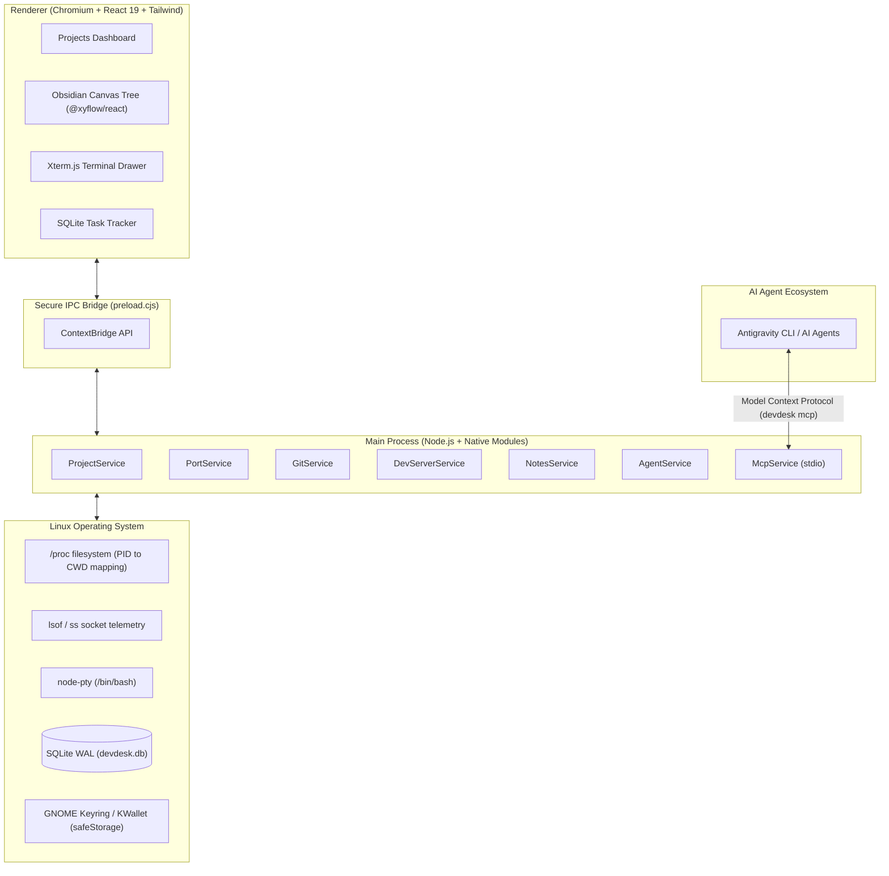

# DevDesk

A developer workstation HUD and command center with deep Linux system integration, process-to-port mapping, an Obsidian-style progress canvas, and a native Model Context Protocol (MCP) server for AI coding agents.

---

## System Architecture



---

## Core Capabilities

- **Process-to-Project Port Mapping**: Scans host network sockets via `lsof` and `ss`. Resolves listening socket PIDs to exact repository roots using `/proc/<pid>/cwd`. Displays process memory (`VmRSS`), uptime, and provides one-click `SIGTERM` / `SIGKILL` termination.
- **Where We Left Off Engine**: Automatically snapshots Git state, uncommitted files, and active ports on exit or workspace switch. Persists daily notes (last task, next step, active blockers) per repository.
- **Obsidian Canvas Roadmap**: Minimalist 2D node graph rendered with `@xyflow/react`. Uses a dark graphite layout with thin connectors and non-distracting status indicators.
- **Antigravity CLI & MCP Integration**: Embedded local stdio Model Context Protocol (MCP) server (`devdesk mcp`). Allows AI agents to read context, inspect the roadmap, update task nodes in real time, and persist session summaries.
- **One-Click Dev Server Management**: Detects scripts across Node.js (`npm`, `pnpm`, `yarn`, `bun`), Rust (`cargo`), Go, and Python. Starts and stops background servers with process tree management.
- **Hardware-Accelerated Terminal**: Linux `/bin/bash` terminal backed by `node-pty` and Xterm.js. Available as both a full view and a global slide-up drawer (`Ctrl + \``).
- **Persistent Local Database**: Backed by embedded SQLite via Drizzle ORM in `~/.config/devdesk/devdesk.db`. Zero network dependency; all data remains local.
- **OS Keychain Vault**: Hardware-backed secret storage using Linux `libsecret` via Electron `safeStorage`.

---

## CLI Reference

DevDesk includes a command-line interface executable via `devdesk` or `node bin/devdesk.js`:

| Command | Description |
| :--- | :--- |
| `devdesk add [path]` | Register a directory into SQLite (defaults to `.`) |
| `devdesk resume [project]` | Print terminal card of branch, dirty files, ports, and next steps |
| `devdesk run [project]` | Launch detected dev server in foreground |
| `devdesk list` | List all tracked projects, branches, and mapped ports |
| `devdesk ports` | Print all host listening sockets mapped to registered projects |
| `devdesk mcp` | Start stdio Model Context Protocol server for AI coding agents |

---

## Quick Start

### Development Mode

```bash
npm install
npm run dev
```

Spawns the local Vite renderer with hot-reload and launches the standalone Electron desktop shell.

### Production Build

```bash
npm run build
npm start
```

---

## Keyboard Shortcuts

| Shortcut | Action |
| :--- | :--- |
| `Ctrl + K` / `Cmd + K` | Spotlight Command Palette |
| `Ctrl + \`` | Toggle Slide-Up Terminal Drawer |
| `Ctrl + B` | Toggle Sidebar Collapse |
| `Alt + 1` | Projects Dashboard |
| `Alt + 2` | Task Tracker (Kanban) |
| `Alt + 3` | Git HUD |
| `Alt + 4` | Ports & Process Inspector |
| `Alt + 5` | Fullscreen Terminal |
| `Alt + 6` | Offline Developer Tools |
| `Alt + 7` | Markdown Scratchpad |
| `Alt + 8` | Settings & Keychain Vault |
| `Escape` | Dismiss Active Modal / Palette |

---

## License

Distributed under the MIT License. See [LICENSE](LICENSE) for details.
